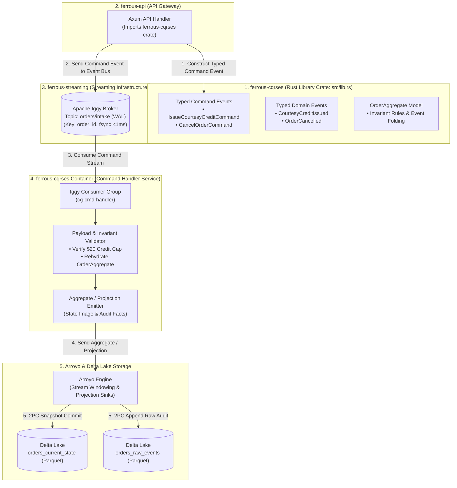

# ferrous-cqrses

[← Back to FerrousCX Root Architecture](https://github.com/reidlai/ferrous-cx)

[](https://github.com/reidlai/ferrous-cx)
[](LICENSE)
[](.github/workflows/devsecops-ci.yml)
[](.pre-commit-config.yaml)
[](#architecture-overview)

**`ferrous-cqrses`** is the core Command-Query Responsibility Segregation and Event Sourcing (CQRS-ES) submodule of the **FerrousCX** enterprise platform. Built in pure Rust, it operates in a **dual-role architecture**:

1. **Rust Library Crate (`src/lib.rs`):**  
   Exports strongly typed **Command Events** (`IssueCourtesyCreditCommand`, `CancelOrderCommand`), **Domain Events** (`CourtesyCreditIssued`, `OrderCancelled`), payload serialization contracts, and domain invariant rules.  
   - **Consumer:** Submodule **`ferrous-api`** imports `ferrous-cqrses` as a Rust crate dependency. Inside its Axum API handlers, `ferrous-api` instantiates typed Command Events from incoming requests and publishes them directly to the event bus / intake topic (`orders/intake`) managed by **`ferrous-streaming`**.
2. **Command Handler Service & Container (`src/bin/server.rs` + `Dockerfile`):**  
   A compiled, standalone Rust microservice container that subscribes to inbound Command Events from Apache Iggy:
   - Consumes command payloads sequentially partitioned by entity ID (`order_id`).
   - Rehydrates the **`OrderAggregate`** root from historical event streams.
   - Enforces all business invariants (e.g. strict **$20.00 / R$ 20,00 courtesy credit cap**, valid lifecycle state transitions, idempotency checks).
   - Produces and sends validated state snapshots as an **Aggregate / Projection** stream to **Arroyo Engine**.
   - **Arroyo** consumes these projections and materializes them into **Delta Lake** (`orders_current_state` and `orders_raw_events`) via 2PC Parquet commits.

---

## 🏛️ Architecture Overview



---

## ⚡ Key Capabilities

1. **Shared Library Crate (`src/lib.rs`):**
   * Exposes canonical Rust structs for all Command Events with Serde JSON/binary serialization support.
   * Eliminates contract drift between the API gateway (`ferrous-api`) and the background command processor.
2. **Business Invariant Enforcement:**
   * Pure compiled Rust domain execution guaranteeing sub-microsecond validation.
   * Enforces business policies: max courtesy credit of $20.00 / R$ 20,00 per order (`courtesy_credit_cents <= 2000`), valid state transitions, and idempotent deduplication via `command_id` (`UUIDv7`).
3. **Sequential Partition Processing:**
   * The Command Handler subscribes to Iggy using partitions hashed on `order_id`. This guarantees strict per-order serial execution without distributed locks.
4. **Arroyo Aggregate & Projection Pipeline:**
   * State updates are formatted as structured Aggregate Projections and emitted to Arroyo.
   * Arroyo uses 2PC commits to write partitioned Parquet records into Delta Lake, creating an up-to-date queryable read model for Apache DataFusion.

---

## 📁 Repository Layout

```text
ferrous-cqrses/
├── .github/workflows/
│   └── devsecops-ci.yml        # Tier 1 Rust CI (clippy, cargo-audit, test)
├── .pre-commit-config.yaml      # Pre-commit hooks (cargo fmt, clippy, gitleaks)
├── Dockerfile                   # Multi-stage container build for Command Handler service
├── Cargo.toml                   # Dual library & binary crate definition
├── src/
│   ├── lib.rs                   # Library crate entrypoint exporting commands & events
│   ├── commands/                # Typed Command Event definitions
│   │   ├── mod.rs
│   │   ├── credit.rs            # IssueCourtesyCreditCommand
│   │   └── dispute.rs           # FlagDisputeCommand, CancelOrderCommand
│   ├── events/                  # Validated Domain Event definitions
│   │   ├── mod.rs
│   │   └── order_events.rs      # CourtesyCreditIssued, OrderStatusUpdated
│   ├── aggregate/               # Event Sourcing aggregate root
│   │   ├── mod.rs
│   │   ├── order.rs             # OrderAggregate with invariant logic ($20 cap)
│   │   └── rehydrate.rs         # Event folding engine
│   ├── projection/              # Aggregate Projection bridges for Arroyo
│   │   ├── mod.rs
│   │   └── arroyo_sink.rs       # Formats and sends state images to Arroyo
│   ├── consumer/                # Iggy TCP consumer for orders/intake
│   │   ├── mod.rs
│   │   └── handler.rs           # Command execution loop & ACK coordinator
│   └── bin/
│       └── server.rs            # Main binary entrypoint for the Docker service
└── README.md                    # Submodule technical documentation
```

---

## 🛠️ Standalone Developer Quickstart

### Prerequisites
* **Rust:** `1.82+` (`rustup update stable`)
* **Docker:** For building the Command Handler container image

### 1. Build and Run Unit Tests
```bash
# Compile library and command handler binary
cargo build --release

# Run invariant and event-folding unit tests
cargo test --all-targets --verbose
```

### 2. Build Container Image
```bash
docker build -t ferrous-cqrses:latest .
```

---

## 🛡️ DevSecOps & Quality Assurance (Tier 1 Rust)

* **Strict Linting:** `cargo clippy --all-targets -- -D warnings`
* **Supply Chain Security:** `cargo audit` and `cargo deny check`
* **Static Analysis:** `semgrep` with OWASP Top 10 rulesets
* **Pre-commit Hooks:** Enforces code formatting and secret scanning (`gitleaks`) before git commits.
