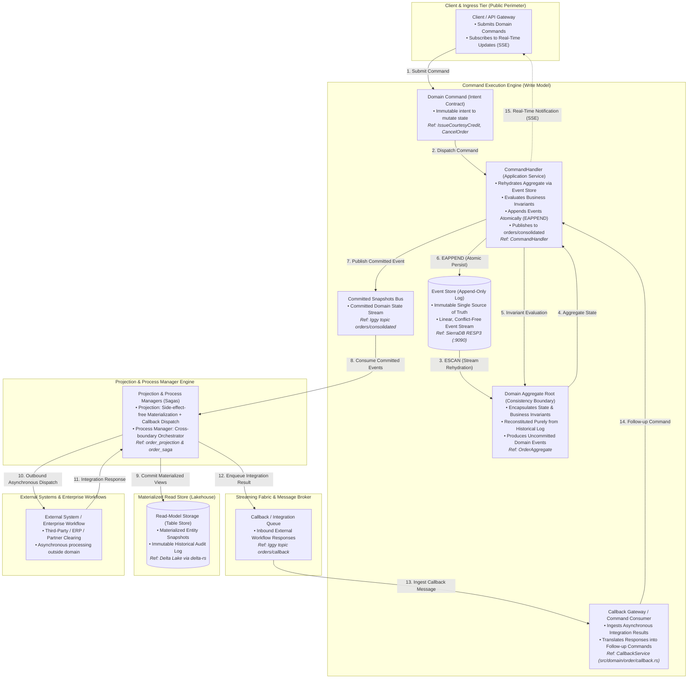
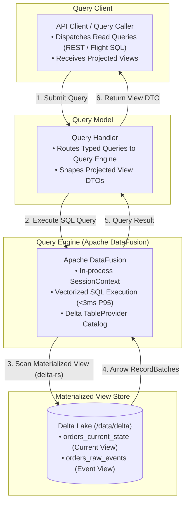
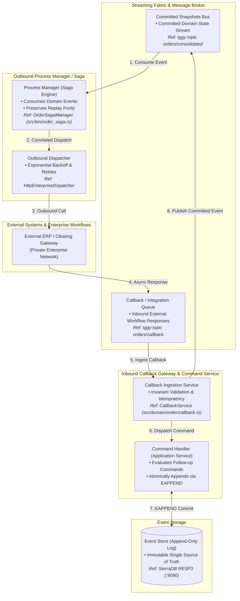

# ferrous-cqrses

[← Back to FerrousCX Root Architecture](https://github.com/reidlai/ferrous-cx)

[](https://github.com/reidlai/ferrous-cx)
[](deny.toml)
[](.github/workflows/devsecops-ci.yml)
[](.pre-commit-config.yaml)
[](#architecture-overview)

**`ferrous-cqrses`** is the core Command-Query Responsibility Segregation and Event Sourcing (CQRS-ES) submodule of the **FerrousCX** enterprise platform. Built in pure Rust, it operates in a **dual-sided architecture** encompassing both Command Mutation and Query Serving:

### A. Command Side (Write Path & Domain Invariants)
1. **Rust Library Crate (`src/lib.rs`):**  
   Exports strongly typed **Command Events** (`CreateOrderCommand`, `IssueCourtesyCreditCommand`, `CancelOrderCommand`), **Domain Events** (`OrderCreatedEvent`, `CreditIssuedEvent`, `OrderCancelledEvent`, `OrderStatusUpdatedEvent`), payload serialization contracts (Serde JSON and Bincode), and domain invariant rules.  
   - **Consumer:** Submodule **`ferrous-api`** imports `ferrous-cqrses` as a compiled crate dependency. Inside its Axum API handlers, `ferrous-api` executes `CommandHandler` synchronously against **SierraDB** (`ESCAN` → Rehydrate Aggregate → Invariant Evaluation → `EAPPEND`) and publishes committed state to **`orders/consolidated`**. Meanwhile, **`orders/intake`** is used directly by **`stream-replay-rs`** to inject raw data into Delta Lake (`orders_raw_events`).
2. **Command Handler Daemon & Service Container (`src/bin/command_handler.rs`):**  
   A compiled, standalone Rust microservice daemon for sequential partitioned command processing:
   - Rehydrates the **`OrderAggregate`** root from historical event streams (`ESCAN`).
   - Enforces all business invariants: strict **$20.00 / 2,000 cents courtesy credit cap (AD-17)**, lifecycle state transition guards, and monotonic `UUIDv7` idempotency deduplication.
   - Atomically appends resulting events (`EAPPEND`) to SierraDB and emits **`ConsolidatedOrderProjection`** snapshots to **`orders/consolidated`**.
3. **Callback Service & Stream Consumer (`src/domain/order/callback.rs`):**  
   An asynchronous queue-based callback consumer (`CallbackConsumer` + `CallbackService`):
   - Consumes enterprise settlement callback messages from Apache Iggy topic **`orders/callback`** (consumer group `cg-order-callback`).
   - Acts symmetrically to `CommandHandler`: rehydrates `OrderAggregate` (`ESCAN`), evaluates domain invariants, and atomically commits resulting domain events (`CourtesyCreditSettled` or `CourtesyCreditSettlementFailed`) via `EAPPEND` to SierraDB.
   - Publishes committed domain state to Apache Iggy (**`orders/consolidated`**) with automatic rollback on publisher failures.

### B. Query Side (Canonical Query Contracts & Embedded Engine Boundary)
4. **Canonical Query Contracts (`src/domain/order/queries.rs`, AD-32):**  
   Exports strongly typed, read-only CQRS Query structs (`GetOrderQuery`, `ListOrdersQuery`) consumed by **`ferrous-api`**, which executes them in-process via its embedded **Apache DataFusion** `OrderQueryEngine` over Delta Lake materialized views (`orders_current_state`, `orders_raw_events`). *(Standalone BI/OLAP query servers and the Agentic Path are deferred to Release 2 per AD-30.)*

---

## 🏛️ System Architecture Topology

`ferrous-cqrses` implements strict **Domain-Driven Design (DDD)** and **Command Query Responsibility Segregation (CQRS)** with **Event Sourcing (ES)**. 

To clearly establish operational boundaries and demonstrate how domain components collaborate, the architecture separates the **Write Model (Commands, Handlers, Aggregates, Event Store, Projections, Saga Orchestration & Callbacks)** from the **Read Model (Projections, Lakehouse & Query Engines)**:

---

### 1. CQRS / ES Architectural Collaboration (Write & Saga Execution Path)

The Write Path demonstrates the fundamental CQRS and Event Sourcing lifecycle: how **Commands**, **Command Handlers**, **Domain Aggregates**, the **Event Store**, the **Streaming Fabric**, **Projections & Process Managers (Sagas)**, and **Callback Consumers** interact. The framework guarantees that business invariants are strictly enforced before appending events, read models are updated without side-effects, and external integrations operate asynchronously via decoupled callback queues:



#### How CQRS-ES Architectural Concepts Collaborate:

| Architectural Concept | CQRS-ES Lifecycle Role & Responsibility | Concrete Reference Implementation (`ferrous-cqrses`) |
| :--- | :--- | :--- |
| **Domain Command** | **Intent Contract:** Immutable data contract encapsulating an external or internal actor's intent to modify state. Does not mutate state directly. | `IssueCourtesyCreditCommand`<br/>`CancelOrderCommand`<br/>`SettleCourtesyCreditCommand`<br/>`FailCourtesyCreditSettlementCommand` |
| **CommandHandler** | **Execution Orchestrator:** Interacts with the Event Store to stream historical events, rehydrates the target aggregate root, validates concurrency/versioning, delegates invariant evaluation, atomically appends resulting events, and publishes to `orders/consolidated`. | `CommandHandler`<br/>(`src/domain/order/handler.rs`) |
| **Domain Aggregate (Root)** | **Guardian of Invariants:** Consistency boundary and state machine maintained strictly by folding historical events (`apply`). Evaluates incoming commands against current domain rules and yields uncommitted domain events if valid, or rejects with strongly typed domain errors. | `OrderAggregate`<br/>(`src/domain/order/aggregate.rs`) |
| **Event Store** | **Single Source of Truth:** High-performance, append-only, immutable linear log guaranteeing strict sequential ordering per stream. Supports stream replay (`ESCAN`) and atomic persistence (`EAPPEND`) without locking relational tables. | `SierraDB` (Port 9090, pure-Rust RESP3 engine)<br/>(`src/sierra.rs`) |
| **Domain Events** | **Historical Facts:** Immutable historical records signifying facts that have already occurred and been durably committed. Broadcast to message brokers for downstream consumption. | `CourtesyCreditIssued`<br/>`OrderCancelled`<br/>`CourtesyCreditSettled`<br/>`CourtesyCreditSettlementFailed` |
| **Projection** | **Read-Model Materializer:** Consumes committed domain state from `orders/consolidated`, folds state into Delta Lake Parquet snapshots via `delta-rs`, and publishes callbacks to `orders/callback`. | `order-projection` (`src/bin/order_projection.rs` & `src/domain/order/projection.rs`), writing Delta Lake Parquet snapshots via `delta-rs`. |
| **Process Manager (Saga)** | **Cross-Boundary Orchestrator:** Listens to committed domain events to coordinate complex, long-running workflows with external systems. Encapsulates side-effects outside of the read model so that historical event replay remains pure. | `order-saga` (`src/bin/order_saga.rs`, `src/domain/order/saga.rs`) |
| **Callback Gateway** | **Asynchronous Loop Closure:** Ingests external responses from dedicated callback queues, enforces deduplication and idempotency, translates integration results into follow-up domain commands, and routes them through the command handler to update aggregate state. | `CallbackService` / `Callback Command Worker`<br/>(`src/domain/order/callback.rs`) |

---

### 2. CQRS / ES Query Model (Read Flow)

Following strict **CQRS / ES**, the **Query Model** focuses exclusively on read-only **Queries** and **Materialized Views** using **Apache DataFusion** as the query engine (Analytics and Agentic paths are deferred to a future version):



* **Pure Query & View Execution:** Powered by **Apache DataFusion** and `delta-rs`, queries against materialized Delta Lake views (`orders_current_state`, `orders_raw_events`) execute in sub-3ms P95 latency without touching SierraDB or replaying event logs.
* **Separation of Concerns:** The Query Model is strictly side-effect free and decoupled from both write-side command/aggregate logic and future Analytics/Agentic workloads.

---

## ⚡ Key Capabilities & Dual-Role Usage

### 1. Shared Library Crate (`src/lib.rs`)
* **Canonical Domain Contracts:** Exports typed commands (`CreateOrderCommand`, `IssueCourtesyCreditCommand`, `CancelOrderCommand`), domain events (`OrderCreatedEvent`, `CreditIssuedEvent`, `OrderCancelledEvent`, `OrderStatusUpdatedEvent`), and aggregates (`OrderAggregate`).
* **Zero Contract Drift:** Shared Rust structs eliminate serialization drift between the API gateway (`ferrous-api`) and backend processing pipelines.
* **Dual Serialization:** Native support for both human-readable JSON (`to_json`, `from_json`) and compact binary encoding (`to_bincode`, `from_bincode`).
* **Prelude Module:** Provides `ferrous_cqrses::prelude::*` for rapid integration.

### 2. Standalone Daemon Service (`src/bin/command_handler.rs`)
* **Sequential Stream Processing:** Subscribes to Apache Iggy (`orders/intake`) partitioned on `order_id`, ensuring strict sequential event processing per entity without distributed locking.
* **Idempotent Ingestion:** Rejects replayed commands using monotonic `UUIDv7` command identifiers without duplicating state changes or publishing redundant projections.
* **Projection Publishing:** Emits lightweight `ConsolidatedOrderProjection` state payloads to `orders/consolidated` for downstream consumption by Arroyo and Delta Lake.
* **Graceful Lifecycle Management:** Traps `SIGINT`/`SIGTERM`/`Ctrl+C` signals to drain active partition buffers and cleanly terminate background tasks.

### 3. Outbound Saga Process Manager (`src/bin/order_saga.rs` & `src/domain/order/saga.rs`)
* **Decoupled Outbound Coordination:** Consumes committed domain state (`CreditIssuedEvent`) from Apache Iggy (`orders/consolidated`) across consumer group `cg-order-saga` to orchestrate outbound integration workflows with external enterprise systems.
* **CQRS/ES Pure Replay Invariant:** Read-side projections remain strictly side-effect free (idempotent folding without external network calls), guaranteeing that disaster recovery replays or re-indexing operations never trigger duplicate side-effects.
* **Resilient Enterprise Dispatcher:** Implements `EnterpriseDispatcher` with HTTP bearer authentication, exponential backoff, retry limits, and correlation tokens (`EnterpriseSettlementRequest`).

### 4. Asynchronous Callback Worker (`src/domain/order/callback.rs`)
* **Queue-Driven Ingress:** Replaces fragile synchronous HTTP webhooks with an asynchronous callback queue (`orders/callback`, consumer group `cg-order-callback`).
* **Deterministic Idempotency:** Translates callback messages into domain commands using deterministic `UUIDv5` command identifiers, discarding duplicate responses idempotently.
* **SierraDB Atomic Commit & Rollback:** Validates aggregate invariants against `OrderAggregate` in SierraDB, atomically commits terminal settlement events (`CourtesyCreditSettled` or `CourtesyCreditSettlementFailed`) via `EAPPEND`, and rolls back in-memory aggregate state if post-commit event publication fails.

### 5. Canonical CQRS Query Contracts (`src/domain/order/queries.rs`)
* **Typed Read Contracts:** Exports `GetOrderQuery` and `ListOrdersQuery` with pagination and input validation (`AD-32`).
* **Embedded Execution in `ferrous-api`:** `ferrous-api` maps HTTP requests into these Query structs and executes them through its in-process `OrderQueryEngine` (in-memory test backend + embedded Apache DataFusion / `deltalake` runtime backend with `_delta_log` version-checked reloads, `AD-31`).

---

## 🔄 External Integration & Asynchronous Callback Architecture

`ferrous-cqrses` provides the complete modular infrastructure for coordinating asynchronous integrations with external enterprise workflows (e.g. ERP, banking settlement, or clearing gateways) without violating event-sourcing invariants:



### 1. Outbound Saga Process Manager (`OrderSagaManager`)
* **Purity Guarantee:** In an event-sourced system, replaying historical events to rebuild projections or recalculate state must never produce side-effects. `order_saga` decouples side-effects into a dedicated process manager listening to `orders/consolidated` under consumer group `cg-order-saga`.
* **Outbound Contracts:** Wraps requests in strongly typed `EnterpriseSettlementRequest` envelopes carrying deterministic correlation tokens and amounts.
* **Retry & Resilience:** `HttpEnterpriseDispatcher` intercepts transient failures (e.g., HTTP 429 rate limits, HTTP 503 service unavailable, TCP timeouts) and retries with jittered exponential backoff up to configured limits before acknowledging message offsets.

### 2. Inbound Queue-Based Callback Service (`CallbackService`)
* **Queue Ingress:** `Projection` / external workflows post asynchronous responses into Apache Iggy (`orders/callback`). The `Callback Service` ingests messages under consumer group `cg-order-callback`, rehydrates `Aggregate`, evaluates invariants, and `EAPPEND`s to SierraDB.
* **Payload Invariant Validation:** Validates `SettlementCallbackMessage` structure (strictly positive amounts, required transaction references for `Settled`, mandatory reasons for `Failed`).
* **Command Translation & Monotonic Idempotency:** Computes deterministic `UUIDv5` command identifiers:
  - Settled: `UUIDv5(order_id:transaction_ref)`
  - Failed: `UUIDv5(order_id:reason:amount_cents)`
  Any redelivered message is idempotently acknowledged as `CallbackOutcome::DuplicateIgnored` without corrupting aggregate history or emitting duplicate events.
* **SierraDB Atomic Commit (`EAPPEND`):** Rehydrates `OrderAggregate`, checks invariants (e.g. lifetime courtesy credit limit, order status not cancelled or fraud-locked), and commits `CourtesyCreditSettled` or `CourtesyCreditSettlementFailed`.
* **Rollback on Downstream Publishing Failure:** If an optional publisher is configured and publication fails, `CallbackService` executes `handler.rollback_last_event(order_id, command_id)` to restore the in-memory aggregate to its prior version, allowing safe retry without state divergence.
* **Notification Hook:** Supports optional `EventListener` callbacks (e.g., enabling upstream API gateways to broadcast real-time Server-Sent Events).

---

## 🔒 Business Invariants & Lifecycle Rules

The `ferrous-cqrses` aggregate state engine enforces strict business invariants defined in the architecture specification:

### 1. Courtesy Credit Limit (AD-15 / FR-7)
* **$20.00 / 2,000 Cents Lifetime Cap:** Total cumulative courtesy credits issued for a single order must never exceed **$20.00 (2,000 cents)** (`MAX_COURTESY_CREDIT_CENTS`).
* **Cumulative Rejection:** Any credit request that causes the aggregate `courtesy_credit_cents` to exceed 2,000 cents is rejected with `DomainError::CourtesyCreditExceeded(attempted, limit)`.
* **Strict Positivity:** Credit amounts must be strictly positive (`amount_cents > 0`). Requests with zero or negative amounts fail with `DomainError::InvalidAmount(amount_cents)`.

### 2. Valid Order State Transitions & Terminal Protection
Orders progress through explicit lifecycle states: `Created` → `InTransit` → `Delivered`, `Cancelled`, or `FraudLocked`. Once an order enters a terminal state, specific operations are permanently prohibited:

| Current Order Status | `IssueCourtesyCreditCommand` | `CancelOrderCommand` | Resulting Error |
| :--- | :--- | :--- | :--- |
| **`Created`** | Allowed (up to \$20.00 cap) | Allowed → transitions to `Cancelled` | None (Success) |
| **`InTransit`** | Allowed (up to \$20.00 cap) | Allowed → transitions to `Cancelled` | None (Success) |
| **`Delivered`** | Allowed (up to \$20.00 cap) | **REJECTED** | `DomainError::OrderDelivered` |
| **`Cancelled`** | **REJECTED** | **REJECTED** | `DomainError::OrderCancelled` |
| **`FraudLocked`** | **REJECTED** | **REJECTED** | `DomainError::OrderFraudLocked` |

---

## ⚙️ Configuration Options

The Command Handler daemon (`src/bin/command_handler.rs`) can be configured via environment variables or command-line arguments (via `clap`):

| Environment Variable | CLI Argument | Default Value | Description |
| :--- | :--- | :--- | :--- |
| `IGGY_SERVER_ADDRESS` | `--iggy-server-address` | `127.0.0.1:8090` | TCP connection string for Apache Iggy streaming broker |
| `IGGY_USERNAME` | `--iggy-username` | `iggy` | Username credential for Iggy broker authentication |
| `IGGY_PASSWORD` | `--iggy-password` | `iggy` | Password credential for Iggy broker authentication |
| `STREAM_NAME` | `--stream-name` | `orders` | Name of the stream containing topics in Iggy |
| `TOPIC_ORDERS_INTAKE` | `--topic-orders-intake` | `intake` | Topic name where incoming command events are ingested |
| `TOPIC_ORDERS_CONSOLIDATED` | `--topic-orders-consolidated` | `consolidated` | Topic name where validated projections are published |
| `CONSUMER_GROUP` | `--consumer-group` | `cg-cmd-handler` | Consumer group identifier for sequential partition consumption |

---

## 📁 Repository Layout

```text
ferrous-cqrses/
├── .github/
│   └── workflows/
│       └── devsecops-ci.yml        # GitHub Actions Tier 1 Rust CI pipeline
├── .pre-commit-config.yaml         # Pre-commit hooks (cargo fmt, clippy, gitleaks, hygiene)
├── Cargo.lock                      # Pinned dependency graph
├── Cargo.toml                      # Dual library & binary crate manifest
├── deny.toml                       # Cargo-deny supply-chain & license configuration
├── scripts/
│   ├── audit-cqrses.sh             # POSIX Tier 1 audit & scan script (6 gates)
│   └── audit-cqrses.ps1            # PowerShell 100% dual-shell parity audit script
├── src/
│   ├── bin/
│   │   ├── command_handler.rs      # Sequential command consumer daemon
│   │   ├── order_handler.rs        # Standalone order mutation service
│   │   ├── order_projection.rs     # Materialized view projection daemon
│   │   └── order_saga.rs           # Outbound saga process manager daemon
│   ├── callback.rs                 # Queue-based CallbackService & settlement contracts
│   ├── consumer.rs                 # StreamConsumer, Config & Iggy consumer abstractions
│   ├── delta.rs                    # Delta Lake Parquet snapshot commit helper (write-side)
│   ├── domain/                     # Pure domain logic (aggregate, commands, events, handler)
│   ├── id.rs                       # Monotonic UUIDv7 generator & parser
│   ├── lib.rs                      # Public library exports & prelude
│   ├── projection.rs               # ConsolidatedOrderProjection & state snapshots
│   ├── publisher.rs                # StreamPublisher trait & Iggy/InMemory publishers
│   ├── saga.rs                     # OrderSagaManager & EnterpriseDispatcher abstractions
│   ├── serialization.rs            # Serde JSON & Bincode serialization utilities
│   └── sierra.rs                   # SierraDB RESP3 event store client & protocol
├── tests/
│   ├── test_callback.rs            # Integration tests for CallbackService & idempotency
│   ├── test_command_handler.rs     # Integration tests for handler & sequential processing
│   ├── test_healthcheck.rs         # Healthcheck and CLI flag probe tests
│   ├── test_library_contracts.rs   # Unit tests for domain models, invariants & serialization
│   ├── test_order_projection.rs    # Tests for order projection materialization
│   ├── test_order_saga.rs          # Tests for saga process manager & retry mechanics
│   ├── test_projection_publishing.rs # Tests for ConsolidatedOrderProjection publishing
│   └── test_sierradb_integration.rs # Tests for SierraDB event store append and scans
└── README.md                       # Submodule architecture & technical documentation
```

---

## 🛠️ Standalone Developer Quickstart

Verify the entire crate (compilation, full test suite of 57 tests, and Tier 1 DevSecOps audit) in **under 3 minutes**:

### 1. Prerequisites
* **Rust:** Stable toolchain (`1.80+`)
* **Components:** `rustfmt`, `clippy` (`rustup component add rustfmt clippy`)
* **Audit Tools (Optional):** `cargo install cargo-audit cargo-deny`

### 2. Format & Lint Verification
```bash
# Check code formatting (fails if unformatted)
cargo fmt -- --check

# Enforce zero clippy warnings across all targets
cargo clippy --all-targets -- -D warnings
```

### 3. Run Comprehensive Test Suite
```bash
# Execute all 121 unit, invariant, and integration tests
cargo test --all-targets --verbose
```

### 4. Execute Tier 1 DevSecOps Security Gate
Run the automated 6-step audit script (POSIX Bash or PowerShell):

```bash
# On Linux / macOS / Git Bash:
./scripts/audit-cqrses.sh

# On Windows PowerShell:
powershell -ExecutionPolicy Bypass -File ./scripts/audit-cqrses.ps1
```

The script verifies:
1. `[1/6]` Code formatting (`cargo fmt -- --check`)
2. `[2/6]` Static analysis & linter (`cargo clippy --all-targets -- -D warnings`)
3. `[3/6]` Unit and integration test pass (`cargo test --all-targets`)
4. `[4/6]` Dependency vulnerability scan (`cargo audit`)
5. `[5/6]` License and supply-chain assurance (`cargo deny check`)
6. `[6/6]` Static application security testing (`semgrep`)

---

## 🛡️ DevSecOps & Supply-Chain Assurance

`ferrous-cqrses` implements enterprise Tier 1 DevSecOps compliance adhering to **AD-13** and **NFR-10..12**:
* **Shift-Left Pre-Commit:** `.pre-commit-config.yaml` intercepts unstaged secrets via `gitleaks`, ensures trailing whitespace / EOF hygiene, and enforces local `cargo fmt`, `clippy`, and `cargo test` runs prior to commit.
* **Supply-Chain Guardrails (`deny.toml`):** Restricts permitted open-source licenses (MIT, Apache-2.0, BSD-3-Clause, Unicode-3.0, CC0-1.0), detects unmaintained transitive dependencies, and rejects yanked crates.
* **Continuous Integration:** `.github/workflows/devsecops-ci.yml` runs automated regression checks on pull requests and pushes to `main` and `epic-*` branches.
