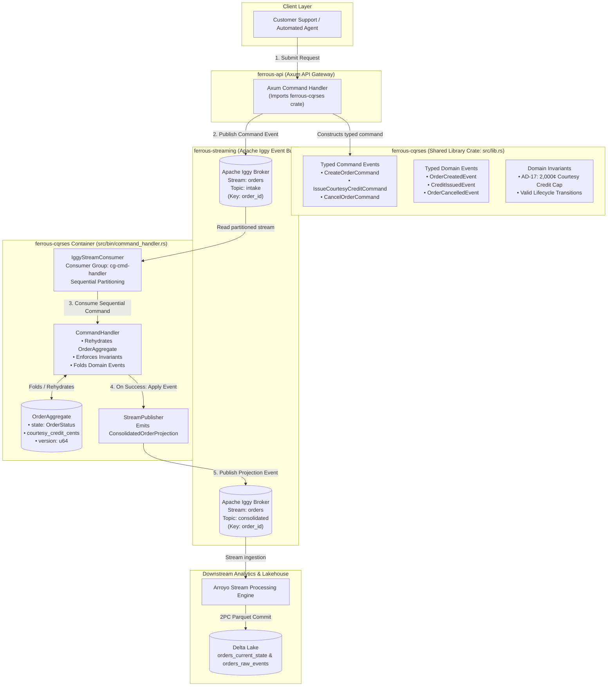

# ferrous-cqrses

[← Back to FerrousCX Root Architecture](https://github.com/reidlai/ferrous-cx)

[](https://github.com/reidlai/ferrous-cx)
[](deny.toml)
[](.github/workflows/devsecops-ci.yml)
[](.pre-commit-config.yaml)
[](#architecture-overview)

**`ferrous-cqrses`** is the core Command-Query Responsibility Segregation and Event Sourcing (CQRS-ES) submodule of the **FerrousCX** enterprise platform. Built in pure Rust, it operates in a **dual-role architecture**:

1. **Rust Library Crate (`src/lib.rs`):**  
   Exports strongly typed **Command Events** (`CreateOrderCommand`, `IssueCourtesyCreditCommand`, `CancelOrderCommand`), **Domain Events** (`OrderCreatedEvent`, `CreditIssuedEvent`, `OrderCancelledEvent`, `OrderStatusUpdatedEvent`), payload serialization contracts (Serde JSON and Bincode), and domain invariant rules.  
   - **Consumer:** Submodule **`ferrous-api`** imports `ferrous-cqrses` as a compiled crate dependency. Inside its Axum API handlers, `ferrous-api` instantiates typed Command Events from incoming HTTP requests and publishes them directly to the event intake topic (`orders/intake`) managed by **`ferrous-streaming`**.
2. **Command Handler Daemon & Service Container (`src/bin/command_handler.rs`):**  
   A compiled, standalone Rust microservice daemon that subscribes to inbound Command Events from Apache Iggy:
   - Consumes command payloads sequentially partitioned by entity ID (`order_id`) across consumer group `cg-cmd-handler`.
   - Rehydrates the **`OrderAggregate`** root from historical event streams.
   - Enforces all business invariants: strict **$20.00 / 2,000 cents courtesy credit cap (AD-17)**, lifecycle state transition guards, and monotonic `UUIDv7` idempotency deduplication.
   - Emits validated state snapshots as **`ConsolidatedOrderProjection`** records to the outbound topic (`orders/consolidated`).
   - Downstream stream processors (e.g. **Arroyo**) consume projections and commit materialized views to **Delta Lake** (`orders_current_state` and `orders_raw_events`) via 2PC Parquet commits.

---

## 🏛️ Architecture Overview



---

## ⚡ Key Capabilities & Dual-Role Usage

### 1. Shared Library Crate (`src/lib.rs`)
* **Canonical Domain Contracts:** Exports typed commands (`CreateOrderCommand`, `IssueCourtesyCreditCommand`, `CancelOrderCommand`), domain events (`OrderCreatedEvent`, `CreditIssuedEvent`, `OrderCancelledEvent`, `OrderStatusUpdatedEvent`), and aggregates (`OrderAggregate`).
* **Zero Contract Drift:** Shared Rust structs eliminate serialization drift between the API gateway (`ferrous-api`) and backend processing pipelines.
* **Dual Serialization:** Native support for both human-readable JSON (`to_json`, `from_json`) and compact binary encoding (`to_bincode`, `from_bincode`).
* **Prelude Module:** Provides `ferrous_cqrses::prelude::*` for rapid integration.

### 2. Standalone Daemon Service (`src/bin/command_handler.rs`)
* **Sequential Stream Processing:** Subscribes to Apache Iggy (`orders/intake`) partitioned on `order_id`, ensuring strict sequential event processing per entity without distributed locking.
* **Idempotent Ingestion:** Rejects replayed commands using monotonic `UUIDv7` command identifiers without duplicating state changes or publishing redundant projections.
* **Projection Publishing:** Emits lightweight `ConsolidatedOrderProjection` state payloads to `orders/consolidated` for downstream consumption by Arroyo and Delta Lake.
* **Graceful Lifecycle Management:** Traps `SIGINT`/`SIGTERM`/`Ctrl+C` signals to drain active partition buffers and cleanly terminate background tasks.

---

## 🔒 Business Invariants & Lifecycle Rules

The `ferrous-cqrses` aggregate state engine enforces strict business invariants defined in the architecture specification:

### 1. Courtesy Credit Limit (AD-15 / FR-7)
* **$20.00 / 2,000 Cents Lifetime Cap:** Total cumulative courtesy credits issued for a single order must never exceed **$20.00 (2,000 cents)** (`MAX_COURTESY_CREDIT_CENTS`).
* **Cumulative Rejection:** Any credit request that causes the aggregate `courtesy_credit_cents` to exceed 2,000 cents is rejected with `DomainError::CourtesyCreditExceeded(attempted, limit)`.
* **Strict Positivity:** Credit amounts must be strictly positive (`amount_cents > 0`). Requests with zero or negative amounts fail with `DomainError::InvalidAmount(amount_cents)`.

### 2. Valid Order State Transitions & Terminal Protection
Orders progress through explicit lifecycle states: `Created` → `InTransit` → `Delivered`, `Cancelled`, or `FraudLocked`. Once an order enters a terminal state, specific operations are permanently prohibited:

| Current Order Status | `IssueCourtesyCreditCommand` | `CancelOrderCommand` | Resulting Error |
| :--- | :--- | :--- | :--- |
| **`Created`** | Allowed (up to \$20.00 cap) | Allowed → transitions to `Cancelled` | None (Success) |
| **`InTransit`** | Allowed (up to \$20.00 cap) | Allowed → transitions to `Cancelled` | None (Success) |
| **`Delivered`** | Allowed (up to \$20.00 cap) | **REJECTED** | `DomainError::OrderDelivered` |
| **`Cancelled`** | **REJECTED** | **REJECTED** | `DomainError::OrderCancelled` |
| **`FraudLocked`** | **REJECTED** | **REJECTED** | `DomainError::OrderFraudLocked` |

---

## ⚙️ Configuration Options

The Command Handler daemon (`src/bin/command_handler.rs`) can be configured via environment variables or command-line arguments (via `clap`):

| Environment Variable | CLI Argument | Default Value | Description |
| :--- | :--- | :--- | :--- |
| `IGGY_SERVER_ADDRESS` | `--iggy-server-address` | `127.0.0.1:8090` | TCP connection string for Apache Iggy streaming broker |
| `IGGY_USERNAME` | `--iggy-username` | `iggy` | Username credential for Iggy broker authentication |
| `IGGY_PASSWORD` | `--iggy-password` | `iggy` | Password credential for Iggy broker authentication |
| `STREAM_NAME` | `--stream-name` | `orders` | Name of the stream containing topics in Iggy |
| `TOPIC_ORDERS_INTAKE` | `--topic-orders-intake` | `intake` | Topic name where incoming command events are ingested |
| `TOPIC_ORDERS_CONSOLIDATED` | `--topic-orders-consolidated` | `consolidated` | Topic name where validated projections are published |
| `CONSUMER_GROUP` | `--consumer-group` | `cg-cmd-handler` | Consumer group identifier for sequential partition consumption |

---

## 📁 Repository Layout

```text
ferrous-cqrses/
├── .github/
│   └── workflows/
│       └── devsecops-ci.yml        # GitHub Actions Tier 1 Rust CI pipeline
├── .pre-commit-config.yaml         # Pre-commit hooks (cargo fmt, clippy, gitleaks, hygiene)
├── Cargo.lock                      # Pinned dependency graph
├── Cargo.toml                      # Dual library & binary crate manifest
├── deny.toml                       # Cargo-deny supply-chain & license configuration
├── scripts/
│   ├── audit-cqrses.sh             # POSIX Tier 1 audit & scan script (6 gates)
│   └── audit-cqrses.ps1            # PowerShell 100% dual-shell parity audit script
├── src/
│   ├── bin/
│   │   └── command_handler.rs      # Daemon binary entrypoint with graceful shutdown
│   ├── aggregate.rs                # OrderAggregate state machine & AD-17 invariant rules
│   ├── commands.rs                 # Typed Command Event schemas & UUIDv7 command IDs
│   ├── consumer.rs                 # Sequential stream consumer & Config parsing
│   ├── error.rs                    # DomainError & InvariantError enums
│   ├── events.rs                   # DomainEvent variants & event sequencing
│   ├── handler.rs                  # Sequential CommandHandler & in-memory event store
│   ├── id.rs                       # Monotonic UUIDv7 generator & parser
│   ├── lib.rs                      # Public library exports & prelude
│   ├── projection.rs               # ConsolidatedOrderProjection & state snapshots
│   ├── publisher.rs                # StreamPublisher trait & Iggy/InMemory publishers
│   └── serialization.rs            # Serde JSON & Bincode serialization utilities
├── tests/
│   ├── test_command_handler.rs     # Integration tests for handler & sequential processing
│   ├── test_library_contracts.rs   # Unit tests for domain models, invariants & serialization
│   └── test_projection_publishing.rs # Tests for ConsolidatedOrderProjection publishing
└── README.md                       # Submodule architecture & technical documentation
```

---

## 🛠️ Standalone Developer Quickstart

Verify the entire crate (compilation, full test suite of 57 tests, and Tier 1 DevSecOps audit) in **under 3 minutes**:

### 1. Prerequisites
* **Rust:** Stable toolchain (`1.80+`)
* **Components:** `rustfmt`, `clippy` (`rustup component add rustfmt clippy`)
* **Audit Tools (Optional):** `cargo install cargo-audit cargo-deny`

### 2. Format & Lint Verification
```bash
# Check code formatting (fails if unformatted)
cargo fmt -- --check

# Enforce zero clippy warnings across all targets
cargo clippy --all-targets -- -D warnings
```

### 3. Run Comprehensive Test Suite
```bash
# Execute all 57 unit, invariant, and integration tests
cargo test --all-targets --verbose
```

### 4. Execute Tier 1 DevSecOps Security Gate
Run the automated 6-step audit script (POSIX Bash or PowerShell):

```bash
# On Linux / macOS / Git Bash:
./scripts/audit-cqrses.sh

# On Windows PowerShell:
powershell -ExecutionPolicy Bypass -File ./scripts/audit-cqrses.ps1
```

The script verifies:
1. `[1/6]` Code formatting (`cargo fmt -- --check`)
2. `[2/6]` Static analysis & linter (`cargo clippy --all-targets -- -D warnings`)
3. `[3/6]` Unit and integration test pass (`cargo test --all-targets`)
4. `[4/6]` Dependency vulnerability scan (`cargo audit`)
5. `[5/6]` License and supply-chain assurance (`cargo deny check`)
6. `[6/6]` Static application security testing (`semgrep`)

---

## 🛡️ DevSecOps & Supply-Chain Assurance

`ferrous-cqrses` implements enterprise Tier 1 DevSecOps compliance adhering to **AD-13** and **NFR-10..12**:
* **Shift-Left Pre-Commit:** `.pre-commit-config.yaml` intercepts unstaged secrets via `gitleaks`, ensures trailing whitespace / EOF hygiene, and enforces local `cargo fmt`, `clippy`, and `cargo test` runs prior to commit.
* **Supply-Chain Guardrails (`deny.toml`):** Restricts permitted open-source licenses (MIT, Apache-2.0, BSD-3-Clause, Unicode-3.0, CC0-1.0), detects unmaintained transitive dependencies, and rejects yanked crates.
* **Continuous Integration:** `.github/workflows/devsecops-ci.yml` runs automated regression checks on pull requests and pushes to `main` and `epic-*` branches.
